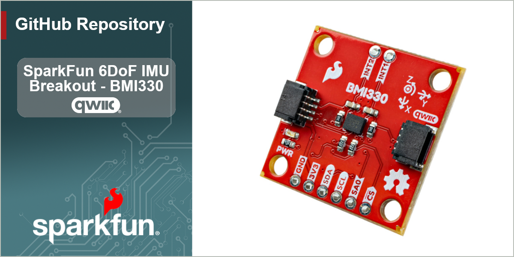

The SparkFun 6DoF IMU Breakout - BMI330 (Qwiic) is a compact, 6-axis inertial measurement unit (IMU) breakout built around the Bosch BMI330. The BMI330 combines a 16-bit triaxial accelerometer and a 16-bit triaxial gyroscope in a single low-power package, making it a great choice for motion tracking, orientation sensing, gesture recognition, and wearable applications.

Designed for our [Qwiic ecosystem](https://www.sparkfun.com/qwiic), the board breaks out the BMI330 over I2C so you can add high-quality motion sensing to your project without any soldering. An onboard programmable interrupt engine handles features like any/no-motion detection, tap and step detection, and orientation recognition directly on the sensor, freeing up your host microcontroller. The two Qwiic connectors let you daisy-chain the board with the rest of your Qwiic devices, and the standard breakout footprint also exposes the I2C and interrupt pins for use with SPI or a solderless breadboard.

## Repository Contents

* **/Documents** - Datasheets, additional product information
* **/Hardware** - KiCad design files (.kicad_sch, .kicad_pcb, .kicad_pro)

## Documentation

* **[Hookup Guide](https://docs.sparkfun.com/SparkFun_Qwiic_IMU_BMI330/)** - Basic hookup guide for the SparkFun 6DoF IMU Breakout - BMI330 (Qwiic).
* **[SparkFun BMI330 Arduino Library](https://github.com/sparkfun/SparkFun_BMI330_Arduino_Library)** - An Arduino library for the SparkFun 6DoF IMU Breakout - BMI330 (Qwiic).

## Product Versions

* **[SEN-31767](https://www.sparkfun.com/sparkfun-6dof-imu-breakout-bmi330-qwiic.html)** - Initial release of the SparkFun 6DoF IMU Breakout - BMI330 (Qwiic).

## License Information

This product is _**open source**_!

Please review the LICENSE.md file for license information.

If you have any questions or concerns about licensing, please contact technical support on our [SparkFun forums](https://forum.sparkfun.com/viewforum.php?f=152).

Distributed as-is; no warranty is given.

_- Your friends at SparkFun._
